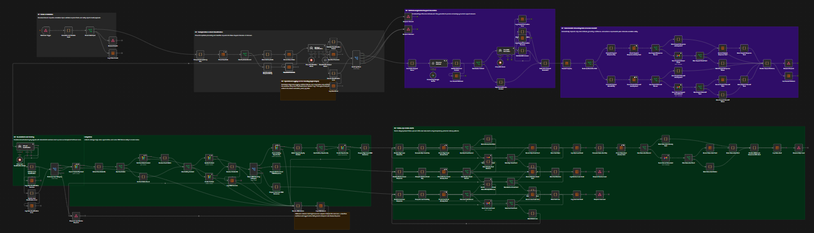
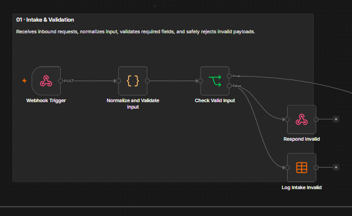
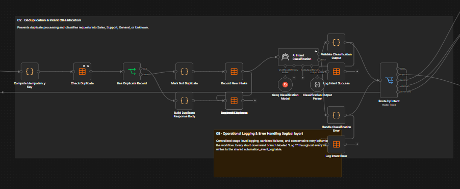
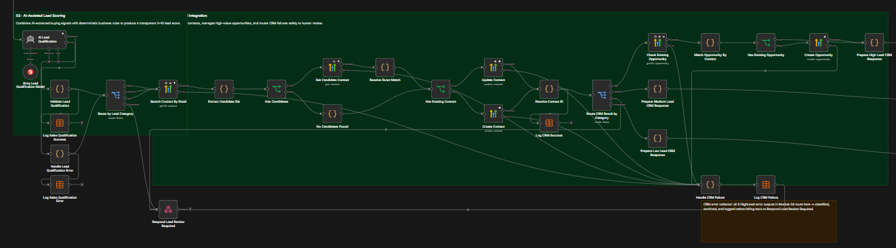
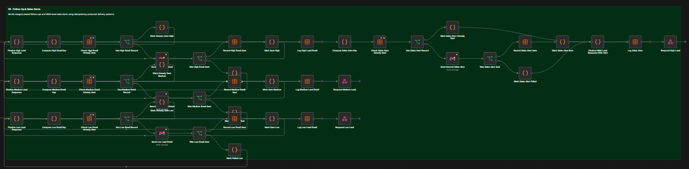
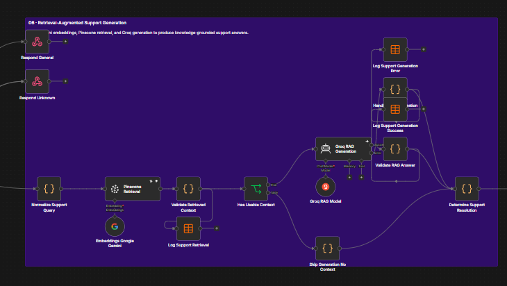
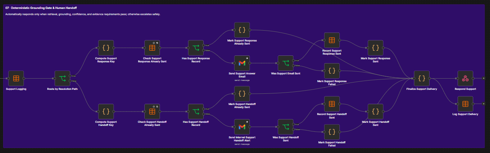

# AI-Powered Lead & Customer Support Automation System

> An end-to-end AI automation system built with n8n for intelligent lead qualification, CRM automation, automated follow-up, RAG-based customer support, deterministic safety controls, human handoff, idempotency protection, and operational observability.


---

## Project Status

**Development build — inactive / unpublished**

This repository contains a sanitized portfolio implementation of an AI-powered business automation system.

The workflow has been tested end-to-end in a controlled DEV environment using connected AI, CRM, email, vector database, and n8n Data Table integrations.

It demonstrates:

- AI-powered request triage
- AI-assisted lead qualification
- Deterministic lead scoring
- CRM automation
- Automated follow-up
- RAG-based customer support
- Deterministic grounding controls
- Human escalation
- Duplicate protection
- Operational logging
- Defensive failure handling

> Client-specific credentials, business rules, CRM configuration, knowledge-base data, security review, and UAT are required before production deployment.

---

# Business Problem

Businesses often receive both **sales inquiries** and **customer support requests** through the same website, form, inbox, or webhook.

Without automation, teams must manually:

- Read every incoming message
- Determine whether it is a sales or support request
- Identify high-value leads
- Update CRM records
- Send follow-up emails
- Search support documentation
- Decide whether an AI-generated answer is reliable
- Escalate uncertain cases
- Track failures and duplicate requests

This can result in:

- Slow lead response
- Inconsistent qualification
- Missed opportunities
- Duplicate CRM actions
- Repeated customer emails
- Support bottlenecks
- AI hallucination risk
- Poor execution visibility

---

# Solution

The workflow provides one intelligent automation layer for both **Sales** and **Customer Support**.

Every incoming request passes through:

```text
Webhook
   ↓
Validation
   ↓
Deduplication
   ↓
AI Intent Classification
   ↓
Sales / Support / General / Unknown
```

Sales requests enter:

```text
AI Lead Qualification
        ↓
Deterministic Lead Scoring
        ↓
HIGH / MEDIUM / LOW
        ↓
HighLevel CRM
        ↓
Customer Follow-Up
        ↓
HIGH Sales Alert
```

Support requests enter:

```text
Google Gemini Embeddings
        ↓
Pinecone Retrieval
        ↓
Groq RAG Generation
        ↓
Deterministic Grounding Gate
        ↓
Auto Response / Human Handoff
```

Operational events are logged throughout the workflow for request-level traceability.

---

# Full Workflow Overview



---

# Workflow Modules

| Module | Name | Responsibility |
|---|---|---|
| 01 | Intake & Validation | Receives, normalizes, and validates incoming requests |
| 02 | Deduplication & Intent Classification | Prevents duplicate processing and identifies request intent |
| 03 | AI-Assisted Lead Scoring | Extracts semantic sales signals and calculates deterministic lead scores |
| 04 | CRM Integration | Resolves HighLevel contacts and manages HIGH-lead opportunities |
| 05 | Follow-Up & Sales Alerts | Sends lead-specific customer emails and HIGH-priority internal alerts |
| 06 | RAG Support | Retrieves knowledge and generates grounded support answers |
| 07 | Grounding Gate & Human Handoff | Controls automated responses and escalates uncertain requests |
| 08 | Operational Logging & Error Handling | Provides centralized event visibility and safe failure handling |

---

# 01 — Intake & Validation

The workflow starts with a single webhook.

Incoming data is normalized before any AI, CRM, email, or RAG operation occurs.

Typical payload:

```json
{
  "name": "Customer Name",
  "email": "customer@example.com",
  "company": "Example Company",
  "job_title": "Operations Manager",
  "budget": "$5000",
  "message": "We need help automating our lead process.",
  "source": "website"
}
```

The validation layer checks:

- Required name
- Valid email format
- Required message

Invalid requests are rejected before downstream business processing.



---

# 02 — Deduplication & Intent Classification

Before processing, the workflow generates an idempotency key from normalized:

```text
email + message
```

The key is checked against the intake Data Table.

If the request has already been processed:

```json
{
  "status": "duplicate",
  "message": "This request has already been received.",
  "duplicate": true
}
```

Processing stops before additional AI, CRM, or email operations.

After deduplication, Groq classifies the request.

| Intent | Purpose |
|---|---|
| `sales` | Sales or automation-service opportunity |
| `support` | Customer support request |
| `general` | General information request |
| `unknown` | Uncertain / low-confidence request |



---

# 03 — AI-Assisted Lead Qualification

Sales requests enter an AI-assisted qualification layer.

The architecture combines:

```text
AI Semantic Analysis
        +
Deterministic Business Rules
```

The LLM extracts business signals, while deterministic code calculates the final score.

## AI-Derived Signals

| Signal | Points |
|---|---:|
| Clear business need | +2 |
| Specific automation requirement | +2 |
| Urgency or timeline | +1 |
| Pricing / demo / call request | +1 |
| Strong purchase intent | +1 |

Maximum AI contribution:

```text
7 points
```

## Deterministic Signals

| Signal | Points |
|---|---:|
| Decision-maker job title | +1 |
| Budget provided | +1 |
| High budget threshold reached | +1 |

DEV high-budget threshold:

```text
>= $10,000
```

Maximum total score:

```text
10
```

## Lead Categories

| Score | Category |
|---:|---|
| 8–10 | HIGH |
| 5–7 | MEDIUM |
| 1–4 | LOW |

Malformed or unreliable AI output is routed toward review instead of generating an unreliable lead score.

---

# 04 — HighLevel CRM Integration

Qualified leads are synchronized with HighLevel CRM.

The CRM flow performs:

```text
Search Contact by Email
        ↓
Resolve Contact
        ↓
Existing?
   ↙         ↘
Update      Create
   ↘         ↙
Resolve Contact ID
        ↓
Route by Lead Category
```

For HIGH leads:

```text
Check Existing Opportunity
        ↓
Existing?
   ↙         ↘
Reuse       Create
   ↘         ↙
Continue Processing
```

This reduces unnecessary duplicate CRM opportunities.



---

# 05 — Automated Follow-Up & Sales Alerts

Each qualified lead category receives an appropriate follow-up.

### HIGH

```text
CRM
 ↓
Customer Follow-Up
 ↓
Internal Sales Alert
```

### MEDIUM

```text
CRM
 ↓
Customer Follow-Up
```

### LOW

```text
CRM
 ↓
Low-Intent Follow-Up
```

Customer emails and internal alerts use dedicated tracking mechanisms to reduce duplicate sends.



---

# 06 — RAG-Based Customer Support

Support requests enter a Retrieval-Augmented Generation pipeline.

```text
Support Query
      ↓
Normalize Query
      ↓
Google Gemini Embedding
      ↓
Pinecone Vector Search
      ↓
Context Validation
      ↓
Groq RAG Generation
      ↓
Answer Validation
      ↓
Deterministic Grounding Gate
```

## RAG Configuration

| Setting | Value |
|---|---|
| Embedding Provider | Google Gemini |
| Embedding Model | `gemini-embedding-2` |
| Vector Dimension | `3072` |
| Vector Database | Pinecone |
| Similarity Metric | Cosine |
| Retrieval | Top 4 |
| Generation Model | `openai/gpt-oss-20b` via Groq |



---

# 07 — Deterministic Grounding Gate

The LLM does not independently decide whether its answer is safe to send.

Auto-response requires:

```text
retrieval succeeded
AND
top similarity score >= 0.75
AND
AI output is well formed
AND
grounded == true
AND
confidence >= 0.70
AND
evidence_used is not empty
```

Formally:

```text
AUTO_RESPONSE ⇔
    retrieval_ok
    ∧ top_score >= 0.75
    ∧ valid_ai_output
    ∧ grounded == true
    ∧ confidence >= 0.70
    ∧ evidence_used != empty
```

If any condition fails:

```text
resolution_path = human_handoff
requires_human = true
```

This prevents uncertain or unsupported AI answers from being automatically sent to customers.

---

# Human Handoff

When the grounding gate fails:

```text
Unsupported / Uncertain Question
             ↓
       Human Handoff
          ↙      ↘
Customer          Internal Team
   ↓                  ↓
Safe Message     Diagnostic Alert
```

The customer receives a safe fallback response.

The internal support team receives the diagnostic context required for follow-up.



---

# Reliability & Idempotency

The workflow implements multiple duplicate-protection layers.

| Protection Layer | Purpose |
|---|---|
| Intake Deduplication | Prevent repeated processing |
| Lead Email Tracking | Prevent repeated customer follow-ups |
| Sales Alert Tracking | Prevent repeated HIGH alerts |
| Support Response Tracking | Prevent repeated RAG auto-responses |
| Support Handoff Tracking | Prevent repeated handoff alerts |
| CRM Opportunity Check | Reduce unnecessary opportunity duplication |

Example tracking keys:

```text
Lead Email:
request_id + email + lead_category

Sales Alert:
request_id + email + high + sales_alert

Support Response:
request_id + email + support_auto_response

Support Handoff:
request_id + email + support_handoff
```

These controls are designed to reduce duplicate side effects.

The project does **not** claim an absolute exactly-once guarantee across third-party APIs.

---

# Retry Strategy

Retries are configured according to side-effect safety.

## Retry Enabled

Examples:

- CRM searches
- CRM reads
- Idempotent contact updates
- Opportunity lookups
- Pinecone retrieval
- Gemini embeddings
- Groq LLM calls
- Data Table lookups

## Blind Retry Disabled

Examples:

- CRM contact creation
- CRM opportunity creation
- Gmail sends
- Data Table inserts

This protects against scenarios where a third-party operation succeeds but its network response is lost and a blind retry could create a duplicate side effect.

---

# Error Handling

The workflow includes defensive failure paths for:

- Invalid input
- Duplicate requests
- AI classification errors
- AI qualification errors
- CRM failures
- Pinecone retrieval failures
- Malformed RAG output
- Customer email failures
- Internal notification failures

CRM failures are:

```text
Caught
  ↓
Classified
  ↓
Sanitized
  ↓
Logged
  ↓
Safe Review Response
```

Sensitive technical details are not returned to the public caller.

---

# Operational Logging

A centralized `automation_event_log` provides request-level observability.

| Field | Purpose |
|---|---|
| `event_id` | Unique event identifier |
| `request_id` | Request correlation |
| `email` | Associated request email |
| `workflow_area` | Functional workflow section |
| `event_type` | Event being recorded |
| `status` | Execution result |
| `severity` | Info / warning / error |
| `node_name` | Originating node |
| `error_code` | Sanitized error classification |
| `error_message` | Sanitized diagnostic information |
| `retryable` | Retry-safety indicator |
| `attempt` | Attempt number |
| `timestamp` | Event timestamp |

Examples of logged areas:

```text
intake
intent_classification
sales_qualification
crm
customer_followup_email
sales_alert
support_retrieval
support_generation
support_delivery
```

---

# Data Tables

The workflow uses seven n8n Data Tables.

| Data Table | Purpose |
|---|---|
| `lead_support_intake_dev` | Request-level deduplication |
| `email_send_tracking` | Lead follow-up email tracking |
| `sales_alert_tracking` | HIGH sales alert tracking |
| `support_query_log` | RAG retrieval and resolution audit |
| `support_response_tracking` | Support auto-response tracking |
| `support_handoff_tracking` | Human-handoff alert tracking |
| `automation_event_log` | Central operational logging |

---

# Technology Stack

| Technology | Purpose |
|---|---|
| **n8n** | Workflow orchestration |
| **Groq** | Intent classification, lead qualification, RAG generation |
| **Google Gemini** | Embedding generation |
| **Pinecone** | Vector database / semantic retrieval |
| **HighLevel / GoHighLevel** | CRM automation |
| **Gmail API** | Customer and internal emails |
| **n8n Data Tables** | State, tracking, and logging |
| **JavaScript / Code Nodes** | Validation, scoring, parsing, safety logic |
| **REST APIs / OAuth2** | External integrations |
| **JSON** | Structured workflow communication |

---

# DEV End-to-End Testing

The system was tested end-to-end in a controlled DEV environment.

## Functional Test Matrix

| Scenario | Result |
|---|---|
| Invalid input validation | ✅ PASS |
| General intent classification | ✅ PASS |
| HIGH lead qualification | ✅ PASS |
| MEDIUM lead qualification | ✅ PASS |
| LOW lead qualification | ✅ PASS |
| Duplicate request detection | ✅ PASS |
| CRM contact resolution | ✅ PASS |
| Existing opportunity reuse | ✅ PASS |
| HIGH customer email | ✅ PASS |
| HIGH internal sales alert | ✅ PASS |
| MEDIUM customer email | ✅ PASS |
| LOW customer email | ✅ PASS |
| RAG retrieval | ✅ PASS |
| Grounded support auto-response | ✅ PASS |
| Unsupported support request | ✅ PASS |
| Human handoff | ✅ PASS |
| Internal support alert | ✅ PASS |
| Operational logging | ✅ PASS |

---

# Lead Qualification Test Results

| Test Lead | Score | Category |
|---|---:|---|
| Strong qualified lead | 10/10 | HIGH |
| Moderate-interest lead | 6/10 | MEDIUM |
| Early-stage future lead | 2/10 | LOW |

---

# RAG Test Results

| Query | Top Score | Grounded | Confidence | Resolution |
|---|---:|---|---:|---|
| Known password-reset question | `0.8356` | Yes | `0.95` | Auto Response |
| Unsupported security-key question | `0.6440` | No | `0` | Human Handoff |

The result demonstrates the intended deterministic safety behavior:

```text
Strong Evidence
→ Auto Response

Insufficient Evidence
→ Human Handoff
```

---

# Repository Files

| File | Purpose |
|---|---|
| [`README.md`](README.md) | Main project overview |
| [`Documentation-Package.md`](Documentation-Package.md) | Detailed technical documentation |
| [`AI Lead & Customer Support Automation.json`](AI%20Lead%20%26%20Customer%20Support%20Automation.json) | Sanitized n8n workflow export |
| [`00-workflow-overview.png`](00-workflow-overview.png) | Full workflow architecture |
| [`01-intake-validation.png`](01-intake-validation.png) | Intake and validation |
| [`02-deduplication-intent-classification.png`](02-deduplication-intent-classification.png) | Deduplication and intent classification |
| [`03-ai-lead-scoring-crm.png`](03-ai-lead-scoring-crm.png) | Lead scoring and CRM |
| [`04-followup-sales-alerts.png`](04-followup-sales-alerts.png) | Follow-up and sales alerts |
| [`05-support-rag.png`](05-support-rag.png) | RAG support pipeline |
| [`06-human-handoff.png`](06-human-handoff.png) | Human handoff |

---

# Installation & Setup

## 1. Import Workflow

Download or clone this repository.

Import:

```text
AI Lead & Customer Support Automation.json
```

into n8n using:

```text
Workflows
→ Import from File
```

Keep the workflow inactive initially.

---

## 2. Configure Credentials

Attach your own credentials for:

- Groq
- Google Gemini
- Pinecone
- HighLevel CRM
- Gmail OAuth2

No credentials are included in the public workflow export.

---

## 3. Configure Pinecone

Create a compatible vector index.

| Setting | Value |
|---|---|
| Type | Dense |
| Dimension | `3072` |
| Metric | Cosine |
| Embedding Model | `gemini-embedding-2` |

Load your own business knowledge base into the index.

---

## 4. Configure HighLevel

Replace environment-specific configuration with your own:

```text
Location / Sub-account

Pipeline

Pipeline Stage

Opportunity Configuration
```

---

## 5. Create Data Tables

Create and map:

```text
lead_support_intake_dev
email_send_tracking
sales_alert_tracking
support_query_log
support_response_tracking
support_handoff_tracking
automation_event_log
```

---

## 6. Configure Email

Replace placeholder values for:

```text
Customer sender

Internal sales alert recipient

Internal support handoff recipient
```

---

## 7. Test Before Activation

Test:

- Invalid payload
- Duplicate payload
- General request
- HIGH lead
- MEDIUM lead
- LOW lead
- Existing CRM contact
- New CRM contact
- Existing opportunity
- Known support question
- Unsupported support question
- Email failure
- CRM failure
- Human handoff

---

# Production Deployment Checklist

Before deploying for a real client:

- [ ] Create a separate PROD workflow
- [ ] Preserve the DEV workflow
- [ ] Use client-owned credentials
- [ ] Configure client HighLevel account
- [ ] Configure client CRM pipeline and stages
- [ ] Create PROD Data Tables
- [ ] Configure customer email sender
- [ ] Configure sales alert recipient
- [ ] Configure support handoff recipient
- [ ] Replace DEV knowledge-base content
- [ ] Configure production Pinecone environment
- [ ] Validate embedding configuration
- [ ] Evaluate RAG threshold with representative client queries
- [ ] Test HIGH / MEDIUM / LOW leads
- [ ] Test duplicate behavior
- [ ] Test CRM failure paths
- [ ] Test email failure paths
- [ ] Test known support questions
- [ ] Test unsupported questions
- [ ] Test human handoff
- [ ] Review security and privacy requirements
- [ ] Complete client UAT
- [ ] Activate production webhook
- [ ] Monitor initial production executions

---

# Security & Privacy

This public repository is intentionally sanitized.

It should not contain:

- API keys
- OAuth tokens
- Passwords
- Credential IDs
- Personal customer data
- Private email addresses
- HighLevel Location IDs
- HighLevel Pipeline IDs
- HighLevel Stage IDs
- n8n Data Table IDs
- Private webhook URLs
- Production secrets
- Private knowledge-base documents

Authentication should be configured through the target n8n credential store.

---

# Known Limitations

### External API Exactly-Once Guarantee

External systems can experience ambiguous network failures.

Therefore this project does not claim absolute exactly-once execution for all third-party side effects.

### CRM Partial Failure Reconciliation

A CRM operation may partially succeed before a later operation fails.

The workflow logs and safely handles these failures, but full automatic reconciliation is not yet implemented.

### AI Parsing Strategy

Intent classification currently uses a Structured Output Parser, while lead qualification and RAG generation use plain JSON with defensive parsing.

The approaches are functional but could be standardized.

### RAG Threshold

The current DEV retrieval threshold is:

```text
0.75
```

This should be evaluated against each client's real knowledge base before production use.

---

# Future Improvements

Potential enhancements include:

- CRM reconciliation
- Dead-letter/manual retry queue
- Slack / Microsoft Teams alerts
- WhatsApp integration
- Voice AI
- Ticketing-system integration
- Human support dashboard
- SLA monitoring
- Operational analytics dashboard
- Lead conversion analytics
- Formal RAG evaluation dataset
- Automated threshold evaluation
- Response-quality scoring
- Multi-channel intake
- Multi-tenant architecture
- CI/CD workflow deployment

---

# Project Completion Status

| Component | Status |
|---|---|
| Architecture | ✅ Complete |
| Intake Validation | ✅ Complete |
| Duplicate Protection | ✅ Complete |
| Intent Classification | ✅ Complete |
| AI Lead Qualification | ✅ Complete |
| Deterministic Lead Scoring | ✅ Complete |
| HighLevel CRM Integration | ✅ Complete |
| Opportunity Handling | ✅ Complete |
| Automated Follow-Up | ✅ Complete |
| HIGH Sales Alert | ✅ Complete |
| Gemini Embeddings | ✅ Complete |
| Pinecone Retrieval | ✅ Complete |
| RAG Generation | ✅ Complete |
| Grounding Gate | ✅ Complete |
| Support Auto-Response | ✅ Complete |
| Human Handoff | ✅ Complete |
| Operational Logging | ✅ Complete |
| Failure Handling | ✅ Complete |
| DEV End-to-End Testing | ✅ Passed |
| Public Export Sanitization | ✅ Complete |
| Portfolio Screenshots | ✅ Complete |
| Client Production Deployment | ⚙️ Client Configuration + UAT Required |

---

# Engineering Principles

This project demonstrates several important automation engineering principles:

1. **Use AI for semantic understanding, not uncontrolled business decisions.**
2. **Combine probabilistic AI with deterministic rules.**
3. **Do not automatically send unsupported RAG answers.**
4. **Escalate uncertainty to humans.**
5. **Treat side-effecting operations differently from read operations.**
6. **Protect outbound actions against duplicate execution.**
7. **Maintain request-level operational traceability.**
8. **Sanitize errors before logging or returning them.**
9. **Separate development and production configuration.**
10. **Perform client-specific UAT before activation.**

---

# Author

## Aminul Islam

**AI Automation Specialist | Oracle APEX & Database Developer**

Focus areas:

- n8n Workflow Automation
- AI Agents
- RAG Systems
- CRM Automation
- API Integration
- Business Process Automation
- Oracle APEX
- Oracle Database
- SQL / PL/SQL

**Portfolio:** https://www.aminulaicloud.com/

---

# Disclaimer

This repository is a **sanitized portfolio and reference implementation**.

It does not contain production credentials, customer data, private knowledge-base documents, or client-specific secrets.

The workflow should be configured, tested, security-reviewed, and validated against the target business environment before production deployment.

---

## Project Summary

```text
                    ONE INTAKE
                        │
                        ▼
              Intelligent AI Triage
                        │
             ┌──────────┴──────────┐
             │                     │
             ▼                     ▼
           SALES                SUPPORT
             │                     │
     AI Qualification       Semantic Retrieval
             │                     │
      Lead Scoring            RAG Generation
             │                     │
      CRM Automation         Grounding Gate
             │                     │
        Follow-Up         Auto Reply / Handoff
             │                     │
        Sales Alert               │
             │                     │
             └──────────┬──────────┘
                        │
                        ▼
             Reliability + Logging
```

**Built to demonstrate how AI can be combined with deterministic engineering controls for safer and more reliable business automation.**
